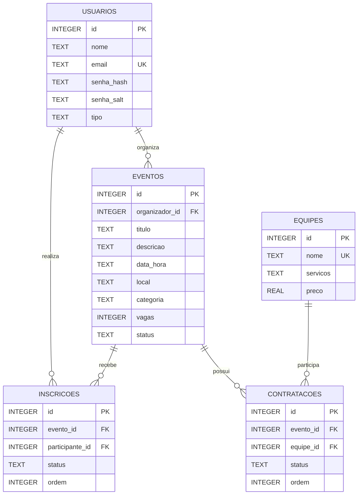

# Modelo do banco de dados — EventFlow Nível 3

O esquema executável está em [`schema.sql`](schema.sql). O SQLite cria as
tabelas automaticamente na primeira execução. As linhas representam chaves
estrangeiras e as marcações indicam a cardinalidade.

## Regras de integridade

- e-mails de usuários e nomes de equipes são únicos;
- todo evento referencia um organizador existente;
- toda inscrição referencia um evento e um participante existentes;
- toda contratação referencia um evento e uma equipe existentes;
- vagas e preços não podem ser negativos;
- os estados aceitos são limitados com restrições `CHECK`;
- inscrições e contratações são removidas em cascata caso o evento seja
  excluído diretamente do banco;
- a ordem das inscrições é persistida para manter a prioridade da lista de
  espera.
