# Diagrama de classes — EventFlow Níveis 1 a 3

O diagrama usa triângulo para herança, losango preto para composição, losango
branco para agregação, linha para associação e linha tracejada para
dependência.

```mermaid
classDiagram
    direction LR

    class Usuario {
        <<abstract>>
        +id_banco: int
        +nome: str
        +email: str
        +senha_hash: str
        +senha_salt: str
        +verificar_senha(senha) bool
        +descricao_perfil() str*
    }

    class Organizador {
        -eventos: list~Evento~
        +descricao_perfil() str
        +criar_evento(...) Evento
    }

    class Participante {
        +descricao_perfil() str
    }

    class GerenciadorUsuarios {
        -usuarios: list~Usuario~
        +cadastrar(...) Usuario
        +autenticar(email, senha) Usuario
        +restaurar(...) Usuario
    }

    class Evento {
        +id_banco: int
        +titulo: str
        +descricao: str
        +data_hora: str
        +local: str
        +categoria: str
        +vagas: int
        +status: StatusEvento
        +publicar(organizador)
        +editar(organizador, ...)
        +demonstrar_interesse(participante) Inscricao
        +cancelar_interesse(participante) Inscricao
        +contratar_equipe(...) ContratacaoDivulgacao
        +cancelar_contratacao(...)
        +substituir_equipe(...)
        +cancelar(organizador)
    }

    class Inscricao {
        +id_banco: int
        +participante: Participante
        +status: StatusInscricao
    }

    class EquipeDivulgacao {
        +id_banco: int
        +nome: str
        +servicos: str
        +preco: float
    }

    class ContratacaoDivulgacao {
        +id_banco: int
        +equipe: EquipeDivulgacao
        +status: StatusContratacao
    }

    class RelatorioEventos {
        +gerar(eventos) str
    }

    class BancoDados {
        +caminho: str
        +carregar() tuple
        +salvar(usuarios, equipes, eventos)
        +resumo() dict
        +fechar()
    }

    class SistemaEventFlow {
        +banco: BancoDados
        +usuarios: GerenciadorUsuarios
        -equipes: list~EquipeDivulgacao~
        +eventos: tuple~Evento~
        +eventos_publicados: tuple~Evento~
        +cadastrar_usuario(...) Usuario
        +criar_evento(...) Evento
        +cadastrar_equipe(...) EquipeDivulgacao
        +demonstrar_interesse(...) Inscricao
        +persistir()
        +resumo_banco() dict
    }

    class MenuEventFlow {
        +sistema: SistemaEventFlow
        +executar()
    }

    Usuario <|-- Organizador : herança
    Usuario <|-- Participante : herança
    GerenciadorUsuarios "1" o-- "0..*" Usuario : agregação
    Organizador "1" -- "0..*" Evento : organiza
    Evento "1" *-- "0..*" Inscricao : composição
    Evento "1" *-- "0..*" ContratacaoDivulgacao : composição
    Inscricao "0..*" --> "1" Participante : associação
    ContratacaoDivulgacao "0..*" --> "1" EquipeDivulgacao : associação
    RelatorioEventos ..> Evento : dependência
    SistemaEventFlow *-- GerenciadorUsuarios : coordena
    SistemaEventFlow *-- BancoDados : persiste
    SistemaEventFlow o-- EquipeDivulgacao : cataloga
    SistemaEventFlow ..> Evento : executa operações
    BancoDados ..> Usuario : reconstrói
    BancoDados ..> Evento : salva
    MenuEventFlow *-- SistemaEventFlow : controla
    MenuEventFlow ..> Usuario : apresenta
```

## Relações de orientação a objetos

- **Herança:** `Organizador` e `Participante` especializam `Usuario`.
- **Polimorfismo:** os dois subtipos implementam `descricao_perfil()` de formas
  diferentes; o menu chama o mesmo método sem conhecer a implementação.
- **Composição:** `Inscricao` e `ContratacaoDivulgacao` são criadas e
  controladas exclusivamente por `Evento`; cancelar o evento cancela suas
  partes ativas.
- **Associação:** um organizador administra eventos, uma inscrição referencia
  um participante e uma contratação referencia uma equipe.
- **Dependência:** `RelatorioEventos` recebe eventos somente enquanto gera o
  relatório e não os guarda como atributos.
- **Agregação:** `GerenciadorUsuarios` reúne usuários que podem existir
  independentemente dele.

## Camadas do Nível 3

- **Domínio (`modelos.py`):** contém entidades, estados e regras de negócio.
- **Banco (`schema.sql`):** define em SQL as tabelas, chaves, relacionamentos e
  restrições de integridade.
- **Persistência (`banco_dados.py`):** executa o esquema e consultas SQL em
  transações, além de reconstruir as relações entre os objetos.
- **Aplicação (`aplicacao.py`):** coordena domínio e banco, persistindo cada
  alteração concluída.
- **Interface (`MenuEventFlow`):** recebe e valida entradas do terminal e exibe
  os resultados.

O esquema das tabelas e suas cardinalidades está em
[modelo_banco.md](modelo_banco.md).
