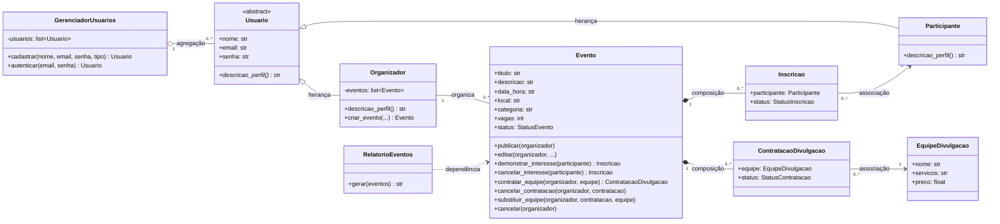

# Diagrama de classes — EventFlow Nível 1

O diagrama abaixo usa a notação UML: triângulo para herança, losango preto
para composição, losango branco para agregação, linha para associação e linha
tracejada para dependência.

## Onde está cada relação

- **Herança:** `Organizador` e `Participante` especializam `Usuario`.
- **Polimorfismo:** os dois subtipos implementam `descricao_perfil()` de formas
  diferentes; uma coleção de `Usuario` chama o mesmo método sem conhecer o
  subtipo concreto.
- **Composição:** `Inscricao` e `ContratacaoDivulgacao` são criadas e
  controladas exclusivamente por `Evento`; ao cancelar o evento, suas partes
  ativas também são canceladas.
- **Associação:** um `Organizador` organiza eventos, uma `Inscricao` referencia
  um `Participante` e uma contratação referencia uma `EquipeDivulgacao`.
- **Dependência:** `RelatorioEventos` recebe objetos `Evento` apenas para gerar
  a saída e não os mantém como atributos.
- **Agregação (relação adicional):** `GerenciadorUsuarios` reúne usuários, mas
  eles não dependem dele para existir.

